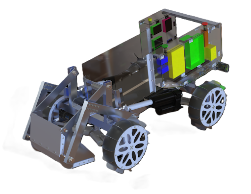

# Laptop Dashboard (Driver Station)

The **Laptop Dashboard** is a web-based **Driver Station** that runs on a laptop and relays between:

- **Human operators** (browser UI + Xbox controllers)
- **The rover Pi** (the `dashboard` ROS 2 package in `RAN-2026-27-Rover-Code`)

The browser never talks to the rover directly for control; the laptop relay sits in between. Video is the exception: the browser pulls H.264 straight from MediaMTX on the Pi.

---

## Architecture

```text
Browser ──WebRTC DataChannels──▶ Laptop relay (server/app.py) ◀──WebRTC DataChannels── Rover Pi
   │                                  HTTP :8765 (UI + SDP signaling only)
   └──────────── WHEP / H.264 ──────────────────────────────────────────▶ MediaMTX on Pi :8889
```

| DataChannel | Delivery              | Direction      | Carries                               |
|-------------|-----------------------|----------------|---------------------------------------|
| `cmd`       | unordered, unreliable | Browser → Pi   | 20 Hz raw controller state            |
| `telemetry` | unordered, unreliable | Pi → Browser   | 10 Hz telemetry frames                |
| `control`   | ordered, reliable     | both           | e-stop, queue, mux, config, alerts    |
| `heartbeat` | unordered, unreliable | both           | liveness / RTT                        |

See [`Laptop-Dashboard/README.md`](Laptop-Dashboard/README.md) for details and [`Laptop-Dashboard/wire_protocol.txt`](Laptop-Dashboard/wire_protocol.txt) for every message.

### Teleoperation

The browser sends raw Xbox state (`c1_*` for controller 1, `c2_*` for controller 2). The Pi republishes it as `sensor_msgs/Joy` on `/joy1` and `/joy2`, and `xbox_controller` decides what each input does.

### What the dashboard shows

- **Rover Drive card**: steering angle per wheel from uros (`/drivetrain/feedback/wheel_curr`), falling back to the `rover_kinematics` command when feedback is stale. Wheel colour/RPS comes from `kraken_drive` (`/drivetrain/telemetry/wheel_state`).
- **Wheel cards / fault table**: Kraken wheel state and fault bits.
- **E-STOP**: latches on the Pi (zeroed `/joy1`/`/joy2`) until cleared; Space bar also triggers it.

---

## Running

From the repo root:

```bash
python3 Laptop-Dashboard/start_dashboard.py
```

This creates `Laptop-Dashboard/.venv` if missing, installs `requirements.txt`, starts the server, and opens `http://localhost:8765`. Press **Ctrl+C** to stop.

## Network configuration

- **Pi → laptop**: set `signaling_url` in the rover repo's `dashboard/config.py` to `http://<laptop-ip>:8765/api/webrtc/pi/offer`.
- **Browser → video**: set the Pi address in `Laptop-Dashboard/web/components/video-panel.js`.

---

## Authors

Benji Sutton

Jacob Earl

Royce Doll
